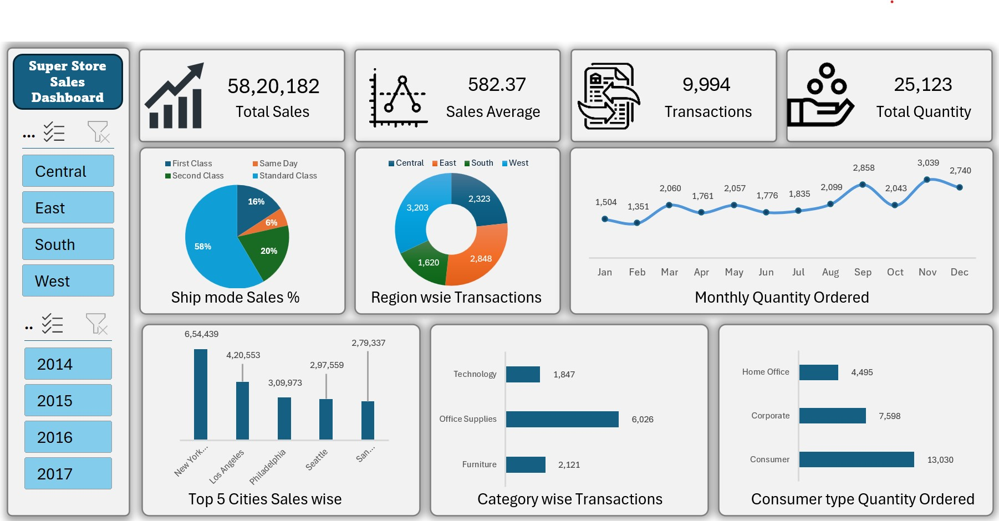

# Super-Store-Sales-Dashboard-Excel
An interactive Super Store Sales Dashboard built using Microsoft Excel to analyze sales performance, transactions, product categories, customer segments, shipping methods, and regional sales. Features KPI cards, dynamic charts, and slicers to identify trends and support data-driven business decisions.
 
Super Store-Sales Dashboard

